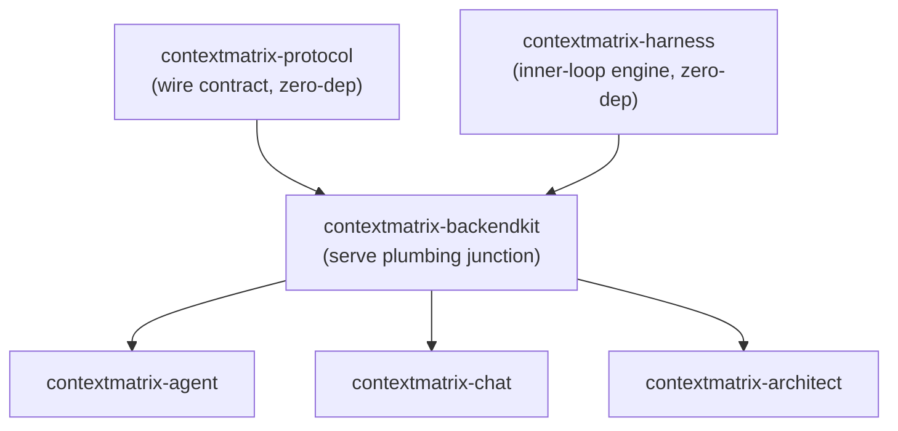

# contextmatrix-backendkit

Shared serve plumbing for the ContextMatrix backends `contextmatrix-agent`,
`contextmatrix-chat` and `contextmatrix-architect`. Agent and chat, the two
execution backends, run a near-identical host service around
`contextmatrix-harness` (webhook auth, task-skills resolution, the worker
stdin frame codec, Prometheus metrics, and log streaming); the architect
mounts the same webhook core and log bridge. All three depend on one copy of
this plumbing instead of their own. The kit also holds `llmproxy`, the per-run
LLM proxy mounted by agent's and chat's serve.

## Architecture



`contextmatrix-protocol` and `contextmatrix-harness` stay zero-dependency by
design - neither can import the other's backend concerns. backendkit is the
one module allowed to depend on both, so it carries the plumbing that needs
pieces of each.

## Governing rule

**Shared behavior only.** The kit holds a piece only when two or more
backends need the same behavior from it. Where their needs differ beyond a small, named
seam, the piece stays per-repo, and the kit never grows backend-specific
semantics.

## Packages

Six named seams. A piece that needs a seventh goes back to per-repo code
instead of growing this list.

| Package | What it holds |
| --- | --- |
| `webhookcore` | HMAC auth middleware, replay cache, the `/message` dedup cache, the SSE `/logs` handler, and the shared HTTP helpers (JSON decode/encode, health (the build and the default worker image's revision, read through an ImageLabeler the serve layer supplies), readyz, images) behind every backend's webhook server. |
| `taskskills` | The signed-GET task-skills pointer fetch and shallow git clone shared by agent's and chat's worker provisioning. |
| `frames` | The JSON Lines control-frame codec written to a worker container's stdin and read back by the work command, with the accepted frame-type set injected per backend. |
| `metrics` | The common Prometheus registry bundle (go/process collectors plus the shared HTTP metrics) built from a per-backend namespace so each backend gets its own metric names. |
| `logbridge` | The fan-out hub and harness-event-to-`protocol.LogEntry` classifier that streams worker output to the UI. A backend can retain a per-key backlog so entries published before its consumer connects are replayed to it. |
| `llmproxy` | The per-run LLM proxy: a stand-in token registry and a reverse proxy that swaps in the real bearer, so workers never hold the LLM key; plus `ValidateContainerURL` and `WorkerBaseURL` for the worker-facing base URL. |

## llmproxy

```
 CM ──trigger (real key)──▶ serve (host)
                            ┌──────────────────────────────┐
                            │ keeps REAL KEY in memory     │
                            │ proxy: token T → REAL KEY    │
                            └──▲─────────────────┬─────────┘
            gives the container│only token T     │ Authorization: REAL KEY
            + proxy URL        │                 ▼
                  ┌────────────┼── worker ─┐   LLM gateway / OpenRouter
                  │ LLM_API_KEY = T (stand-in)
                  │ LLM_BASE_URL = http://host.docker.internal:<port>/llm
                  │ worker ──Authorization: T──▶ proxy on serve
                  │ bad dependency: reads T   │
                  └───────────┬───────────────┘
                              │ sends T out
                              ▼
            T at the gateway   → rejected (the gateway has never seen T)
            T at serve's proxy → reachable only inside the trusted network,
                                 and dead once the run ends
```

A backend calls `Register(runKey, endpoint)` at launch and gives the worker the
returned token and `WorkerBaseURL(containerURL, port, prefix)`, after checking
the configured container URL with `ValidateContainerURL`. The worker's calls to
`POST <prefix>/chat/completions` and `GET <prefix>/models` carry the token; the
proxy replaces it with the real bearer (none for a keyless upstream). The
backend calls `Revoke(runKey)` on exit and on launch failure.

## Versioning policy

backendkit follows the harness operating model, not protocol's: v0.x,
additive changes preferred, breaking changes allowed with coordinated
lockstep consumer bumps, tags cut only when a consumer needs one. There are
three consumers and this is an internal library - protocol's never-break
contract would be ceremony here.

## Verification

```bash
make fmt && make test && make test-race && make lint && make deps-gate && make build
```

`make deps-gate` enforces the boundary: no dependency on any ContextMatrix
backend or server repo, and `contextmatrix-harness` usage confined to
`events` and `redact`.
